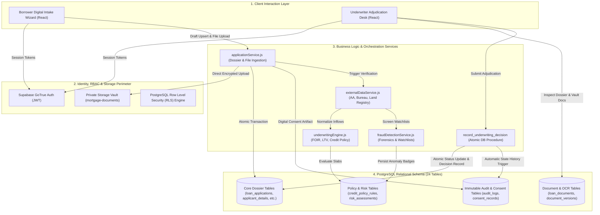
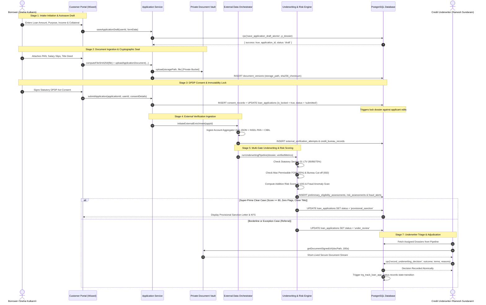

# NIRNAY — Unified End-to-End Mortgage Underwriting Workflow

**System:** NIRNAY Digital Mortgage Underwriting Engine  
**Target Organization:** Hero Housing Finance Limited (HHFL)  
**Research Phase:** Phase 1 — Reference Research & Product Reverse Engineering  
**Scope:** Complete lifecycle blueprint unifying all 8 hackathon capabilities into one seamless, compliant underwriting operating model.  
**Products Supported:** Home Loans (Purchase, Construction, Resale) & Loans Against Property (LAP - Business/Liquidity).  

---

## 1. High-Level Architectural Topology

NIRNAY is structured as a modular, event-driven digital underwriting platform. It decouples the customer-facing intake portal from the core credit policy engine, external verification orchestrator, and underwriter adjudication workspace while maintaining strict database transactional consistency.



---

## 2. End-to-End 10-Stage Underwriting Workflow



---

## 3. Product Differentiation: Home Loan vs. Loan Against Property (LAP)

NIRNAY supports distinct operational pathways and underwriting criteria for **Home Loans** versus **Loans Against Property (LAP)**.

| Underwriting Parameter | Home Loan (Purchase / Construction / Resale) | Loan Against Property (LAP) | Regulatory / Business Rationale |
|---|---|---|---|
| **Loan Purpose** | Acquisition or construction of residential dwelling unit. | Business expansion, working capital, debt consolidation, personal liquidity. | LAP is classified as a non-housing, commercial liquidity facility. |
| **Statutory LTV Ceiling** | **Mandatory RBI Section 31 Caps:**<br>&bull; &le; ₹30L: **90%**<br>&bull; ₹30L &ndash; ₹75L: **80%**<br>&bull; &gt; ₹75L: **75%** | **Configurable Lender Benchmark:**<br>&bull; Illustrative **60.0%** ceiling (Subject to internal credit committee policy). | RBI statutory LTV caps govern individual residential housing loans. LAP collateral cushions must be deeper to absorb commercial liquidity volatility. |
| **Treatment of Stamp Duty & Registration** | **Strictly Excluded** from property cost calculation (RBI HFC Master Direction Section 31). | **Strictly Excluded** from property valuation base. | Prevents dilution of actual physical collateral margin by intangible statutory taxes. |
| **Max Permissible FOIR** | **55.0%** (Configurable prime standard). | **50.0%** (More conservative cashflow buffer). | Commercial cashflows carry higher cyclical default correlation than residential shelter cashflows. |
| **Max Amortization Tenure** | **Up to 30 Years (360 Months)** (Subject to retirement age). | **Up to 15 Years (180 Months)**. | Asset-liability matching for long-term mortgage vs medium-term business facility. |
| **Legal Title Scrutiny** | Builder NOC, RERA registration, registered sale deed / agreement to sell. | Complete 30-year unbroken chain of title deeds from mother deed; search at Sub-Registrar Office; no encumbrance. | In LAP, the borrower already owns the asset; verification must confirm no prior equitable mortgage exists. |
| **Valuation Basis** | $\min(\text{Agreement Value}, \text{Technical Realizable Value})$. | Pure **Independent Realizable Market Value** (TVR). | No sale agreement exists in LAP refinancing; reliance is 100% on empaneled valuer appraisal. |

---

## 4. Stage-by-Stage Operational Specifications

### Stage 1: Intake & Draft Autosave
* **Data Entering:** Loan type (`home_loan` / `lap`), purpose, requested amount, tenure, applicant identity, employer name, declared income, collateral address.
* **Processing:** Validates required fields; checks whether `existingAppId` exists.
* **Database Operations:** Calls `save_application_draft_atomic` RPC to upsert `loan_applications`, `applicant_details`, `employment_details`, `financial_details`, and `property_details` within a single database transaction.
* **Exit Condition:** Application saved with `status = 'draft'`, `is_locked = false`.

### Stage 2: Document Ingestion & Cryptographic Hashing
* **Data Entering:** Raw file bytes (PDF / PNG / JPEG) for identity, income proofs, bank statements, and title deeds.
* **Processing:** 
  1. Size (&le; 15MB) and MIME validation.
  2. Native Web Crypto API SHA-256 calculation producing verified 64-character lowercase hex digest.
  3. Construction of isolated storage path: `{application_id}/{category}/{timestamp}_{clean_filename}`.
* **Database Operations:** Stores file in private `mortgage-documents` bucket; inserts metadata row into `loan_documents` and authentic checksum row into `document_versions`.
* **Exit Condition:** Documents uploaded with verified cryptographic hash.

### Stage 3: Digital Consent & Application Lock
* **Data Entering:** Explicit checkbox confirmation for credit bureau pull, financial data ingestion, and DPDP Act processing.
* **Processing:** Captures user IP address, user-agent string, and timestamp.
* **Database Operations:** Inserts immutable row into `consent_records` (`legal_text_version = 'v2025.1-rbi'`); updates `loan_applications` to `status = 'submitted'`, `is_locked = true`.
* **Exit Condition:** PostgreSQL triggers permanently lock dossier child tables against customer edits.

### Stage 4: External Data Orchestration
* **Data Entering:** PAN number, mobile number, bank account details.
* **Processing:** 
  1. NSDL PAN lookup: verifies active status and exact name match.
  2. Account Aggregator (AA) ingestion: parses 6-month statement into salary credits, average monthly balance (AMB), and inward return charges.
  3. CIBIL Bureau inquiry: extracts score, active tradelines, and DPD delinquency history.
* **Database Operations:** Logs attempts in `external_verification_attempts`; persists bureau data in `credit_bureau_records`.
* **Exit Condition:** Financial metrics normalized into structured JSON.

### Stage 5: Deterministic Credit Policy & Statutory Evaluation
* **Data Entering:** Composite dossier metrics (income, obligations, loan amount, property valuation, bureau score).
* **Processing:**
  1. Computes reducing balance EMI, actual FOIR, and actual LTV.
  2. Evaluates statutory Section 31 LTV caps (90/80/75%).
  3. Evaluates product-specific policies (HL vs LAP).
  4. Enforces statutory minimum 1-day cooling-off floor.
* **Database Operations:** Inserts comprehensive rule evaluation array into `preliminary_eligibility_assessments`.
* **Exit Condition:** Assessment tagged as `passed`, `referred`, or `declined`.

### Stage 6: Fraud Screening & Anomaly Detection
* **Data Entering:** Document metadata, OCR extracted fields, applicant contact details.
* **Processing:**
  1. Compares name on PAN, bank account, and application form using string similarity algorithms.
  2. Inspects PDF metadata for prohibited graphic design software.
  3. Screens applicant against PEP (Politically Exposed Persons) and AML sanctions watchlists.
* **Database Operations:** Inserts detected anomalies into `fraud_alerts` and regulatory compliance records into `compliance_checks`.
* **Exit Condition:** Fraud risk severity tagged (`CRITICAL`, `WARNING`, `INFO`).

### Stage 7: Transparent Risk Scoring
* **Data Entering:** Bureau attributes, cashflow stability, collateral margin, employment vintage.
* **Processing:** Aggregates multi-attribute scorecard into a 0-100 numerical score; categorizes into `super_prime`, `prime`, `near_prime`, or `subprime`. Identifies top 4 contributing positive and negative score drivers.
* **Database Operations:** Persists score and driver attributions in `risk_assessments`.
* **Exit Condition:** Risk tier and risk-based pricing spread calculated.

### Stage 8: Collateral Legal Scrutiny (LSR) & Technical Valuation (TVR)
* **Data Entering:** Property title documents, municipal sanctions, site inspection photographs, physical boundaries.
* **Processing:**
  1. Legal Track: Verifies 30-year unbroken chain of title and encumbrance certificate (EC).
  2. Technical Track: Empaneled valuer conducts physical inspection, measures carpet area, and determines Fair Market Value (FMV) and Realizable Value.
  3. Recomputes statutory LTV based strictly on $\min(\text{Agreement Value}, \text{Realizable Value})$.
* **Database Operations:** Updates `property_details` with verified valuation amounts and title status.
* **Exit Condition:** Collateral approved with definitive legal marketability.

### Stage 9: Automated Decisioning & Adjudication Routing
* **Data Entering:** Consolidated outputs from Stages 5 through 8.
* **Routing Logic:**
  * **Auto-Approval (STP):** Risk score &ge; 80, LTV &le; statutory cap - 5%, FOIR &le; 45%, clean title, zero fraud flags. Automatically transitions to provisional sanction.
  * **Adverse Action (Auto-Decline):** Hard statutory LTV breach, active bureau write-off, unmarketable title, or critical fraud flag. Automatically outputs adverse action reason codes.
  * **Referred (Human Review):** Borderline FOIR (50-55%), minor valuation shortfall, or thin credit history. Enters underwriter workspace queue.
* **Database Operations:** Executed atomically via `record_underwriting_decision` RPC, writing to `underwriting_decisions`, `decision_reasons`, and updating `loan_applications.status`.
* **Exit Condition:** Application transitions to `approved`, `rejected`, or `referred`.

### Stage 10: Explainability & Audit Closure
* **Data Entering:** Final adjudication verdict and decision reasons.
* **Processing:**
  1. Generates Key Fact Statement (KFS) with Annual Percentage Rate (APR) and statutory cooling-off look-up schedule.
  2. Provides What-If counterfactual scenario guidance for referred or declined borrowers.
  3. Finalizes immutable audit log record.
* **Database Operations:** Handled by trigger `trg_track_loan_app_status` logging to `application_status_history` and `audit_logs`.
* **Exit Condition:** Decision finalized with non-repudiation audit trail.

---

## 5. Underwriter Referral & Exception Policy Matrix

Applications are diverted from Straight-Through Processing (STP) into the **Underwriter Review Queue** under the following deterministic conditions:

```
+-----------------------------------+--------------------+---------------------------------------------------------+
| Trigger Condition                 | Severity Level     | Mandatory Underwriter Mitigation Requirement            |
+-----------------------------------+--------------------+---------------------------------------------------------+
| FOIR between 50.1% and 55.0%       | Moderate Cashflow  | Verified liquid assets > 6 months EMIs OR co-borrower    |
| LAP LTV between 55.1% and 60.0%   | Collateral Margin  | Self-occupied residential property in Tier-1 city       |
| Bureau Score between 650 and 700  | Near-Prime Credit  | 24-month zero DPD track record on existing mortgages    |
| Document Name Mismatch (85-95%)   | Identity Anomaly   | Verified DigiLocker pull or legal name change gazette   |
| Valuation Shortfall (5-10%)       | Collateral Deficit | Downward revision of loan amount to maintain LTV cap    |
| Employment Vintage < 2 Years      | Stability Concern  | Continuous employment proof with zero gap > 30 days     |
+-----------------------------------+--------------------+---------------------------------------------------------+
```

